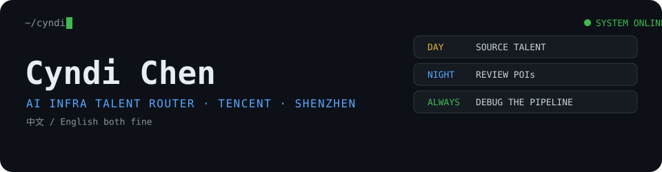

### `01` — SIGNALS I TRACK

### `02` — WHAT I DO

> A little tech. A little market intelligence.
> Enough context to find the right people for hard problems.

Recruiting AI Infra talent across China and globally — from experienced engineers to interns and students.

**My actual stack:**

`Talent Mapping` → `Technical Context` → `Market Intelligence` → `Talent Matching`

### `03` — OPEN CHANNEL

Open to conversations about AI Infra, interesting systems, hard-to-find talent, and where the ecosystem is heading.

---

*Some machines move tensors. I move conversations.*

